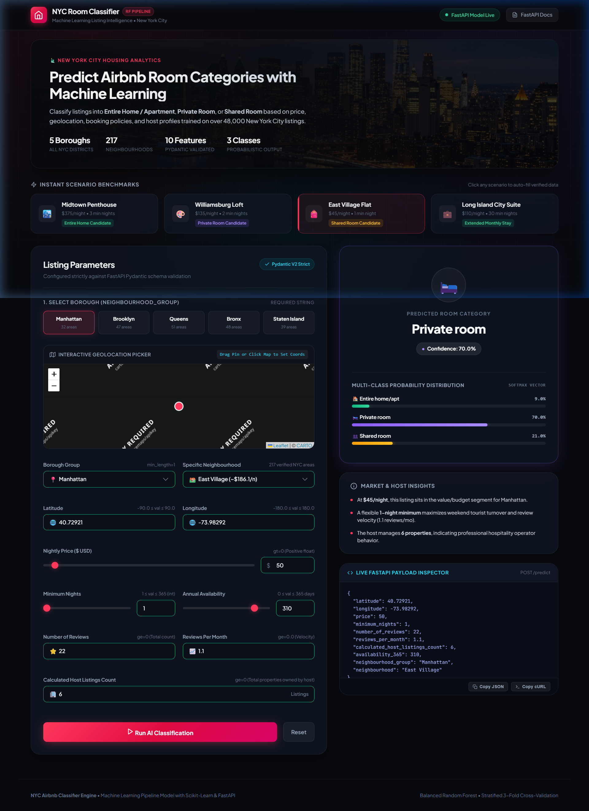
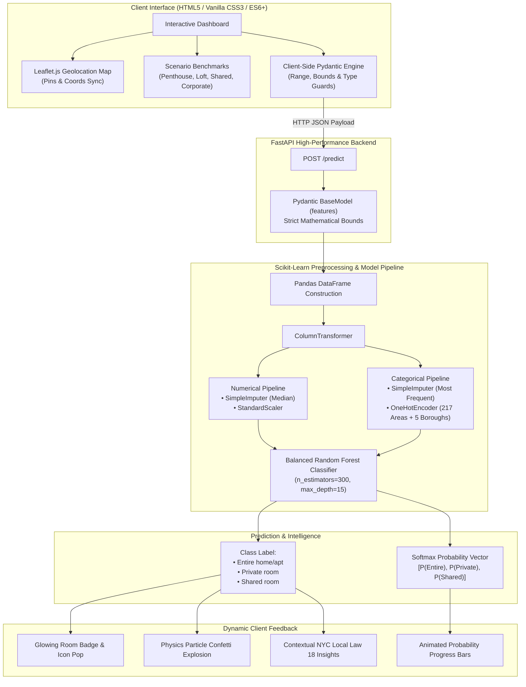

<div align="center">

# 🗽 NYC Airbnb Room Classification Intelligence

[](https://fastapi.tiangolo.com/)
[](https://python.org)
[](https://scikit-learn.org/)
[](https://docs.pydantic.dev/)
[](https://leafletjs.com/)
[](https://nyc-air-bnb-1-krwy.onrender.com/)
[](https://nyc-air-bnb-eikp.onrender.com)
[](https://developer.mozilla.org/en-US/docs/Web/JavaScript)
[](https://opensource.org/licenses/MIT)

<p align="center">
  <strong>An end-to-end Machine Learning system & luxury analytical web application that predicts New York City short-term rental categories with Scikit-Learn, FastAPI, and an interactive frontend.</strong>
</p>

<p align="center">
  🚀 <strong>Live Web App:</strong> <a href="https://nyc-air-bnb-1-krwy.onrender.com/">nyc-air-bnb-1-krwy.onrender.com</a> &nbsp;|&nbsp;
  🌐 <strong>Cloud API:</strong> <a href="https://nyc-air-bnb-eikp.onrender.com">nyc-air-bnb-eikp.onrender.com</a> &nbsp;|&nbsp;
  📖 <strong>Swagger Docs:</strong> <a href="https://nyc-air-bnb-eikp.onrender.com/docs">Interactive Swagger UI</a>
</p>

[🚀 Live App](https://nyc-air-bnb-1-krwy.onrender.com/) •
[🌐 Cloud API](https://nyc-air-bnb-eikp.onrender.com) •
[Features](#-key-features) •
[Architecture](#-system-architecture) •
[ML Pipeline](#-machine-learning-pipeline) •
[Pydantic Schema](#-schema--pydantic-validation) •
[Quickstart](#-quickstart--installation) •
[API Docs](#-api-specification)

<br/>



</div>

---

## 🌟 Executive Summary

The **NYC Airbnb Room Classifier** is a full-stack data science and machine learning web platform. Trained on over **48,800+ real-world New York City Airbnb listings** across all five boroughs, the application determines whether a property listing is an **Entire home/apt**, a **Private room**, or a **Shared room** based on its spatial footprint, pricing strategy, booking availability, and host characteristics.

The application pairs a **Scikit-Learn Balanced Random Forest pipeline** with a **FastAPI** backend and an **interactive Vanilla JavaScript/CSS3 frontend** featuring live Leaflet maps, real-time Pydantic schema validation, and physics-driven micro-interactions.

---

## 🏛 System Architecture

The following diagram illustrates the end-to-end lifecycle from user interaction to feature transformation and inference:



---

## ✨ Key Features

### 🎨 Frontend & Design System
* **Midnight Slate & Airbnb Coral Theme**: Built using an HSL-tailored dark palette (`#07090e`, `#131b2a`) with glassmorphism, dynamic frosted overlays (`backdrop-filter: blur(20px)`), and radial glow accents.
* **Ambient Floating Orbs**: Smooth GPU-accelerated orb animations floating in the background with randomized phases and multi-layered blurs.
* **Laser Shine & Staggered Reveals**: Staggered `fade-in-up` entrances on load, continuous button laser light sweeps, and spring-physics badge bounces.
* **Physics Confetti Particle Engine**: Zero-dependency HTML5 Canvas particle system shooting celebratory, color-coded confetti sparks matching the predicted room class.
* **Smooth Easing Number Counters**: Probabilities animate smoothly from 0% to the target decimal percentage using cubic ease-out interpolation (`requestAnimationFrame`).

### 🗺️ Geolocation & Real-Time Sync
* **Leaflet.js Map Integration**: Dark CARTO basemap tiles with zero watermarking.
* **Bidirectional Pin Binding**: Dragging the pin or clicking anywhere on the map dynamically populates the `latitude` and `longitude` fields in real time with precision formatting.
* **Cascading Borough & Neighbourhood Explorer**:
  - Fast-select chips for all **5 Boroughs** (*Manhattan, Brooklyn, Queens, Bronx, Staten Island*).
  - Searchable dropdown covering all **217 authentic NYC neighbourhoods** loaded with historical average nightly price benchmarks.

### ⚡ Production-Grade FastAPI & Pydantic Engine
* **Strict Validation Guards**: The frontend mirrors the backend Pydantic schema precisely. If any mathematical rule is violated (e.g. `price <= 0` or `minimum_nights > 365`), input fields shake with haptic feedback and display clear visual warnings.
* **Dual Content Negotiation**: The root endpoint `/` intelligently serves the graphical UI for web browsers (`Accept: text/html`) while continuing to return the programmatic greeting for automated scripts and test clients.
* **Live Developer API Inspector**: Real-time JSON viewer displaying the exact payload transmitted to `/predict`, along with one-click **Copy JSON** and **Copy cURL** utilities.

---

## 🔬 Machine Learning Pipeline

### 1. Data Cleaning & Feature Engineering
* **Dataset**: AB_NYC_2019 dataset featuring **48,895** listings across New York City.
* **Outlier Capping**: Handled extreme long-tail price and stay spikes by capping prices and minimum nights at the 99th percentile rather than discarding rows.
* **Missing Value Handling**: Imputed `reviews_per_month` with `0` for new listings that had zero lifetime reviews.
* **Irrelevant Feature Pruning**: Dropped uninformative identifier columns (`id`, `name`, `host_name`, `host_id`, `last_review`).

### 2. Imbalance Resolution & Cross-Validation
* **Class Imbalance**: In the raw dataset, *Entire home/apt* (~52%) and *Private room* (~45%) dominate, while *Shared room* represents only ~2.4% of all listings.
* **Balanced Weights**: Configured `class_weight='balanced'` in the tree estimators to inversely adjust weights proportional to class frequencies, ensuring the model does not starve the minority class.
* **Stratified Validation**: Evaluated with a **33% holdout test set** using `stratify=y` to preserve exact target class distributions across training and evaluation sets.
* **Evaluation Metric**: Scored using **Macro F1 Score** (unweighted mean of F1 scores across all three classes), which prevents majority class accuracy illusions.

### 3. Pipeline Hyperparameter Configuration
```python
Pipeline(steps=[
    ('preprocessor', ColumnTransformer(transformers=[
        ('numerical', Pipeline([
            ('impute', SimpleImputer(strategy='median')),
            ('scale', StandardScaler())
        ]), ['latitude', 'longitude', 'price', 'minimum_nights',
             'number_of_reviews', 'reviews_per_month',
             'calculated_host_listings_count', 'availability_365']),
        ('categorical', Pipeline([
            ('impute', SimpleImputer(strategy='most_frequent')),
            ('encode', OneHotEncoder(handle_unknown='ignore'))
        ]), ['neighbourhood_group', 'neighbourhood'])
    ])),
    ('classifier', RandomForestClassifier(
        class_weight='balanced',
        n_estimators=300,
        max_depth=15,
        min_samples_split=2,
        random_state=42
    ))
])
```

---

## 📋 Schema & Pydantic Validation

Every field accepted by the API is declared in the `features` Pydantic model in [`main.py`](main.py):

| Field Name | Type | Validation Constraints | Description |
| :--- | :---: | :--- | :--- |
| `latitude` | `float` | `ge=-90.0`, `le=90.0` | Geodetic latitude coordinate |
| `longitude` | `float` | `ge=-180.0`, `le=180.0` | Geodetic longitude coordinate |
| `price` | `float` | `gt=0.0` | Nightly booking price in USD |
| `minimum_nights` | `int` | `ge=1`, `le=365` | Minimum booking length requirement |
| `number_of_reviews` | `int` | `ge=0` | Lifetime review count |
| `reviews_per_month` | `float` | `ge=0.0` | Monthly review velocity |
| `calculated_host_listings_count` | `int` | `ge=0` | Total listings managed by host |
| `availability_365` | `int` | `ge=0`, `le=365` | Annual open booking days |
| `neighbourhood_group` | `str` | `min_length=1` | NYC Borough (*Manhattan, Brooklyn, Queens, Bronx, Staten Island*) |
| `neighbourhood` | `str` | `min_length=1` | Specific neighbourhood name (*217 areas*) |

---

## 📂 Project Structure

```bash
NYC_classification_project/
├── main.py                     # FastAPI backend, Pydantic model & API routing
├── nyc_calssification_model.py # Data science EDA, pipeline training & hyperparameter tuning
├── Model_Pipeline.pkl          # Compressed trained Scikit-Learn pipeline artifact (~17MB)
├── index.html                  # Accessible HTML5 frontend dashboard
├── requirements.txt            # Python environment dependencies
├── static/
│   ├── css/
│   │   └── style.css           # Custom design system, dark theme & keyframe animations
│   ├── js/
│   │   ├── app.js              # Leaflet integration, Pydantic validation & API client
│   │   └── neighbourhoods-data.js # Geolocation index & price metrics for 217 NYC areas
│   └── img/
│       ├── nyc_skyline.jpg     # Cinematic twilight hero banner
│       └── dashboard_preview.png # Application UI showcase preview
└── README.md                   # Project documentation
```

---

## 🚀 Quickstart & Installation

### Prerequisites
- Python 3.10, 3.11, or 3.12
- Pip / Virtualenv

### 1. Clone & Set Up Virtual Environment
```bash
git clone https://github.com/your-username/NYC_classification_project.git
cd NYC_classification_project

# Create a virtual environment
python -m venv .venv

# Activate the virtual environment
# On Windows:
.venv\Scripts\activate
# On Linux/macOS:
source .venv/bin/activate
```

### 2. Install Dependencies
```bash
pip install -r requirements.txt
```

### 3. Launch the Application Server
Run the FastAPI application with Uvicorn:
```bash
uvicorn main:app --reload --host 127.0.0.1 --port 8000
```

### 4. Open in Your Browser
- **Live Cloud Web App**: [https://nyc-air-bnb-1-krwy.onrender.com/](https://nyc-air-bnb-1-krwy.onrender.com/)
- **Live Cloud API**: [https://nyc-air-bnb-eikp.onrender.com](https://nyc-air-bnb-eikp.onrender.com)
- **Live OpenAPI Swagger Docs**: [https://nyc-air-bnb-eikp.onrender.com/docs](https://nyc-air-bnb-eikp.onrender.com/docs)
- **Local Development UI**: [http://127.0.0.1:8000/app](http://127.0.0.1:8000/app) (or [http://127.0.0.1:8000/](http://127.0.0.1:8000/))

---

## 📡 API Specification

### Endpoint: `POST /predict`
Executes classification on a candidate property listing.

#### Request Headers
```http
Content-Type: application/json
Accept: application/json
```

#### Request Body Sample
```json
{
  "latitude": 40.75889,
  "longitude": -73.98513,
  "price": 375.0,
  "minimum_nights": 3,
  "number_of_reviews": 45,
  "reviews_per_month": 2.1,
  "calculated_host_listings_count": 2,
  "availability_365": 220,
  "neighbourhood_group": "Manhattan",
  "neighbourhood": "Midtown"
}
```

#### Response Body Sample (`200 OK`)
```json
{
  "predicted_room_type": "Entire home/apt",
  "probability": [
    0.74,
    0.26,
    0.0
  ]
}
```
*Note: The probability array corresponds to `['Entire home/apt', 'Private room', 'Shared room']`.*

#### Sample cURL Command (Live Production API)
```bash
curl -X 'POST' \
  'https://nyc-air-bnb-eikp.onrender.com/predict' \
  -H 'accept: application/json' \
  -H 'Content-Type: application/json' \
  -d '{
    "latitude": 40.75889,
    "longitude": -73.98513,
    "price": 375,
    "minimum_nights": 3,
    "number_of_reviews": 45,
    "reviews_per_month": 2.1,
    "calculated_host_listings_count": 2,
    "availability_365": 220,
    "neighbourhood_group": "Manhattan",
    "neighbourhood": "Midtown"
  }'
```

---

## 🎯 Instant Scenario Presets

The frontend provides four pre-calibrated listing profiles representing distinct market segments:

1. **Midtown Penthouse (Entire Home Candidate)**:
   - *Manhattan, Midtown* • \$375/night • 3 min nights • 45 reviews • Low host density.
2. **Williamsburg Designer Studio (Private Room Candidate)**:
   - *Brooklyn, Williamsburg* • \$135/night • 2 min nights • High review velocity (3.8/mo).
3. **East Village Flat (Shared Room Candidate)**:
   - *Manhattan, East Village* • \$45/night • 1 min night • Host manages 6+ properties.
4. **Long Island City Suite (Corporate Monthly Stay)**:
   - *Queens, Long Island City* • \$110/night • 30 min nights (Local Law 18 compliant).

---

## 📜 License & Acknowledgments

This project is open-source and available under the [MIT License](LICENSE).

- **Dataset**: Provided by [Inside Airbnb](http://insideairbnb.com/) via Kaggle (`dgomonov/new-york-city-airbnb-open-data`).
- **Map Tiles**: Basemaps courtesy of [CARTO](https://carto.com/) and [OpenStreetMap](https://www.openstreetmap.org/).
- **Icons & Typography**: Plus Jakarta Sans, JetBrains Mono, and SVG iconography.

<div align="center">
  <sub>Engineered with precision for Machine Learning practitioners, Full-Stack engineers, and NYC real estate analysts.</sub>
</div>
